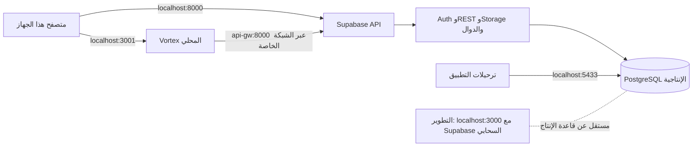

# تجهيز قاعدة بيانات الإنتاج على Docker المحلي

هذا الدليل يشغّل نسخة محلية مستقلة لـVortex وSupabase على جهاز Windows الحالي. لا يجهّز خادمًا عامًا ولا يربط التطبيق بالسحابة. يمكن إدارة Docker وCompose من PowerShell؛ Ubuntu أو توزيعة WSL ليست مطلوبة. آخر تحقق تشغيلي: 2026-11-07؛ التطبيق ومكدس Supabase يعملان محليًا، والنسخ الاحتياطي والاستعادة اختُبرا كما هو موضح أدناه.

إذا كنت تجهز جهاز عميل جديدًا، استخدم [دليل تثبيت العميل خطوة بخطوة](windows-customer-installation.md).

## 1. النتيجة المقصودة

| الجزء | العنوان على الجهاز | الاستخدام |
| --- | --- | --- |
| نسخة التطبيق المحلية الإنتاجية | `http://localhost:3001` | المنفذ المنشور على جهازك؛ صورة التطبيق `vortex-erp:local-production` والحاوية `vortex-erp-local-production` |
| Supabase API | `http://localhost:8000` | اتصال المتصفح بالتوثيق وREST وStorage والدوال |
| PostgreSQL الإنتاجية | `127.0.0.1:5433` | الترحيلات والنسخ الاحتياطي من هذا الجهاز فقط |
| تطبيق التطوير | `http://localhost:3000` | `npm run dev`؛ يستخدم إعداد Supabase في ملف `.env` |
| قاعدة التطوير | مشروع Supabase السحابي المضبوط في `.env` | لا توجد قاعدة تطوير محلية في Docker |

يكون اتصال التطبيق داخل Docker إلى `http://api-gw:8000` على شبكة `supabase_default`. أما المتصفح فيستخدم `localhost:8000`. تُربط المنافذ المنشورة بـ`127.0.0.1` حتى لا تستقبل اتصالات من الشبكة المحلية. لا يعمل Caddy ولا تُستخدم نطاقات عامة.



> هذه نسخة محلية على جهاز واحد. لن يصل إليها موظف من جهاز آخر، ولن تعمل إذا أُغلق الجهاز أو Docker Desktop. استخدامها عبر الإنترنت أو كخدمة متاحة للفروع يتطلب إعداد نشر منفصلًا وHTTPS ونسخًا احتياطية خارج الجهاز.

## 2. حالة التشغيل المحلية الحالية

### فحص محدث في 2026-11-07

آخر فحص بعد تشغيل البيئة:

- Docker Desktop متصل بمحرك Linux؛ افحص الإصدار والذاكرة عند الحاجة عبر `docker version` و`docker info`.
- افحص المساحة الحرة على `C:` قبل تنزيل تحديثات كبيرة؛ هذه القيمة تتغير مع الاستخدام.
- Ubuntu أو WSL غير مطلوبتين؛ سكربت التهيئة المحلي يستخدم Git Bash عبر غلاف PowerShell.
- ملفات البيئة المحلية موجودة ومهيأة، ولا تُضاف إلى Git.
- صور التطبيق وSupabase اللازمة موجودة محليًا، وبُني التطبيق بنجاح.
- تشغيل التطبيق وSupabase مع `--pull never` نجح؛ كل الحاويات سليمة. بقيت بيئة التطوير منفصلة ولم تُعدّل.

**النتيجة:** تم تنزيل الصور اللازمة وبناء صورة التطبيق وتشغيل المكدس المحلي. اختُبر التشغيل باستخدام `--pull never` و`--no-build`، وبدأت جميع الخدمات بصحة سليمة دون طلب صور من الشبكة. هذا يثبت جاهزية التشغيل دون سحب صور؛ لم يُفصل اتصال الإنترنت فعليًا عن Windows. البريد الخارجي والتحديثات والتكاملات السحابية تظل بحاجة إلى اتصال.

أعد فحص المساحة قبل تحديث الصور. متطلبات Supabase المنشورة تشير إلى 4 GB RAM و40 GB SSD حدًا أدنى، وتوصي بـ8 GB RAM و80 GB SSD. لا تحذف صور أو وحدات Docker الحالية لتوفير المساحة.

راجع [متطلبات Supabase الرسمية](https://supabase.com/docs/guides/self-hosting/docker#system-requirements) قبل التنفيذ.

## 3. ملفات التجهيز التي أضيفت

- `deploy/supabase-local-production.override.yaml`: يعزل منفذ API وقاعدة البيانات على loopback، ويوقف منافذ Supavisor المنشورة.
- `deploy/compose.local-production.override.yaml`: يربط التطبيق المحلي على المنفذ `3001`، ولا يفتح التطبيق إلا على loopback.
- `deploy/app.local-production.env.example`: يشرح القيم المتوقعة للعنوان المحلي؛ لا يحتوي أسرارًا فعلية.
- `npm run db:selfhosted:bootstrap:local`: يهيئ مكدس Supabase محليًا بإصدار رسمي مثبّت عبر PowerShell وGit Bash، وينشئ مفاتيح جديدة، ويكتب `.env.local-production`، ويجهز وظائف Edge الموجودة في المشروع. لا يحتاج Ubuntu أو WSL، لكنه يحتاج اتصالًا لتنزيل إعدادات المصدر، ولا يبدأ Docker أو يسحب الصور.
- `npm run db:selfhosted:protect:local`: يقيّد صلاحية قراءة ملفي الأسرار على حساب Windows الحالي وSYSTEM وAdministrators. ملفات `chmod 600` داخل مسار `/mnt/c` قد لا تحصل وحدها على صلاحيات Windows المطلوبة.
- `npm run db:selfhosted:push:local`: يشغّل أداة Windows PowerShell، ويفحص تكرار إصدارات ملفات الترحيل، ثم يطبق المعلّق على قاعدة `127.0.0.1:5433` ويسأل عن التأكيد قبل الترحيل والبذور. لا يحتاج Ubuntu بعد اكتمال تجهيز Supabase.
- `npm run db:selfhosted:owner:local`: ينشئ حساب المالك الأول بأمر صريح بعد اكتمال الترحيلات. يطلب كلمة المرور دون عرضها، ولا يفعّل قاعدة «أول حساب يصبح مالكًا».

ملف `.env.local-production` ومجلد `deploy/supabase-stack/` مستثنيان من Git وسياق بناء Docker. لا تنسخ الأسرار إلى `VITE_*` سوى مفتاح النشر العام؛ يبقى `SUPABASE_SECRET_KEY` في بيئة الخادم فقط.

## 4. تجهيز Windows عند توفر الإنترنت

تأكد من تثبيت Git for Windows وNode.js وDocker Desktop مع Compose 2.24.4 أو أحدث. لا تثبّت Ubuntu ولا محرك Docker إضافيًا.

من PowerShell في جذر المشروع، شغّل:

```powershell
npm run db:selfhosted:bootstrap:local
```

يستخدم الغلاف `scripts/bootstrap-local-production.ps1` Git Bash المرفق مع Git for Windows لتشغيل سكربت الإعداد، ثم يقيّد صلاحية ملفات الأسرار عبر Windows ACL. يسحب الإعداد الرسمي المثبّت على `self-hosted/v0.8.3`، ويولّد أسرارًا جديدة، وينسخ وظائف Edge المطلوبة. لا يطبع الأسرار، ويرفض الكتابة فوق إعداد موجود، ولا ينفذ `docker compose pull` أو `up`. عناوين Auth ستكون `http://localhost:8000/auth/v1`، وموقع التطبيق `http://localhost:3001`، والتسجيل العام والهاتف والتأكيد التلقائي معطلة.

يتطلب إعداد Supabase اتصالًا لمرة واحدة لتنزيل ملفات الإصدار الرسمي. ملفات الأسرار تُنشأ على هذا الجهاز ولا تُرفع أو تُشارك.

مصدر الإعداد المثبّت: [Compose الرسمي للإصدار v0.8.3](https://raw.githubusercontent.com/supabase/supabase/self-hosted/v0.8.3/docker/docker-compose.yml) و[ملف إعداداته](https://raw.githubusercontent.com/supabase/supabase/self-hosted/v0.8.3/docker/.env.example). لا تشغّل الملف الرسمي مباشرة؛ استخدم ملفات التعديل المحلية المرفقة بهذا المشروع.

### ج. فحص الإعداد قبل أي تنزيل

من PowerShell في جذر المشروع:

```powershell
docker compose --project-name supabase --env-file deploy/supabase-stack/.env `
  -f deploy/supabase-stack/docker-compose.yml `
  -f deploy/supabase-stack/docker-compose.local-production.override.yaml config --quiet

docker compose --env-file deploy/.env.local-production `
  -f deploy/compose.production.yaml `
  -f deploy/compose.local-production.override.yaml config --quiet
```

الأمران يقرآن الإعداد فقط ولا ينشئان حاويات. إذا ظهر خطأ، أوقف التنفيذ وراجعه قبل سحب الصور. لا تستخدم `docker compose config` دون `--quiet` لأن المخرجات الكاملة قد تتضمن أسرار البيئة.

### د. تنزيل الصور وتشغيل Supabase المحلي الإنتاجي

نفذ هذه المرحلة فقط بعد توفر إنترنت ومساحة كافية. الأمر `pull` هو الذي يستهلك الإنترنت:

```powershell
docker compose --project-name supabase --env-file deploy/supabase-stack/.env `
  -f deploy/supabase-stack/docker-compose.yml `
  -f deploy/supabase-stack/docker-compose.local-production.override.yaml pull
```

بعد اكتمال السحب، شغّل المكدس وانتظر صحته:

```powershell
docker compose --project-name supabase --env-file deploy/supabase-stack/.env `
  -f deploy/supabase-stack/docker-compose.yml `
  -f deploy/supabase-stack/docker-compose.local-production.override.yaml up -d --wait
```

قاعدة الإنتاج المحلية معزولة في مجلد بياناتها وشبكتها الخاصة. لا تنفذ `supabase start`؛ تطوير التطبيق يستخدم مشروع Supabase السحابي المعرّف في `.env`.

## 5. تطبيق مخطط قاعدة البيانات والبذور

المسار النشط الآن هو `supabase/migrations/` ويحتوي 17 ملف ترحيل. الترحيلات
القديمة محفوظة دون تعديل في `supabase/migrations_legacy/`. لا تشغّل هذا الإجراء
على قاعدة قائمة أو سحابية؛ السكربت يرفض المتابعة إذا وجد كائنات في `public` أو
ترحيلات مسجلة. إذا سبق تشغيل dry-run فقط، يسمح بجدول سجل فارغ.

نفذ من PowerShell في جذر المشروع بعد أن تصبح قاعدة Supabase سليمة:

```powershell
npm run db:selfhosted:push:local
```

السكربت:

1. يتحقق من ملفات الترحيل الـ17 ومن عدم تكرار إصداراتها.
2. يتصل فقط بقاعدة PostgreSQL على `127.0.0.1:5433` ويتحقق أن مخططها فارغ، ثم
   يعرض dry-run ويطلب كتابة `APPLY SELF-HOSTED MIGRATIONS`.
3. يطبق خط الأساس دون `reset`، ثم يطلب تأكيدًا ثانيًا بكتابة
   `SEED SELF-HOSTED PRODUCTION` ويطبق البذور النظامية فقط.

لأن قاعدة Docker المحلية تجعل `postgres` محدودًا عن مالك كائنات Supabase، يمنح
السكربت محليًا عضوية `supabase_admin` لدور `postgres` كي تنجح أوامر تعيين المالك
في الترحيلات. لا يجري هذا التغيير على أي اتصال خارج مكدس Docker المحلي.

تشمل البذور النظامية الوحدات والخطط ودليل الحسابات الهرمي ووحدات القياس
وتصنيفات المصروفات وترقيم المستندات وطرق الدفع والشركاء الأساسيين وإعدادات
التكاليف والفترات المرجعية وأنواع الحبوب وحاوية النسخ الخاصة. سكربت التهيئة
يتجاوز `06_platform_admins.sql` وبيانات العينات تلقائيًا. قاعدة الجهاز الحالية
تحتوي بالفعل على 4 حسابات إدارة وبيانات مطحنة؛ راجع صلاحية الحسابات وغيّر
كلمات المرور قبل تسليم الجهاز أو فتحه لمستخدمين آخرين. لا تشغّل بذور العينات
على قاعدة عميل دون مراجعة محتواها.

## 6. إنشاء المالك الأول وتسجيل الدخول

قاعدة البيانات لا تجعل أول مستخدم مالكًا تلقائيًا عمدًا. بعد اكتمال الترحيلات والبذور، أنشئ المالك صراحة:

```powershell
npm run db:selfhosted:owner:local
```

الأداة تتحقق أن هدفي المتصفح والخادم مضبوطين على Docker المحلي، وأن جدول المستخدمين والأدوار خاليان، ثم تنشئ الحساب عبر Supabase Auth Admin وتمنحه دور `owner` صراحة. كلمة المرور مطلوبة بحد أدنى 16 حرفًا وتُقرأ كحقل مخفي. إذا وجدت الأداة مستخدمًا أو دورًا سابقًا، تتوقف كي لا تغيّر الصلاحيات القائمة. إذا توقفت بعد إنشاء حساب Auth وقبل تعيين الدور، فقد يكون الحساب موجودًا بلا صلاحية؛ افحصه يدويًا قبل أي إعادة محاولة.

بعدها شغّل نسخة التطبيق المحلية:

```powershell
docker compose --env-file deploy/.env.local-production `
  -f deploy/compose.production.yaml `
  -f deploy/compose.local-production.override.yaml build app

docker compose --env-file deploy/.env.local-production `
  -f deploy/compose.production.yaml `
  -f deploy/compose.local-production.override.yaml up -d app
```

افتح `http://localhost:3001` وسجّل الدخول بحساب المالك الذي أنشأته. الـEdge Function `admin-create-user` تُنسخ أثناء التهيئة لتعمل إضافة الموظفين من واجهة إدارة المستخدمين. لا يوجد تحويل تلقائي إلى مشروع Supabase السحابي عند تعطل Docker.

## 7. التحقق بعد التشغيل

```powershell
docker compose --project-name supabase --env-file deploy/supabase-stack/.env `
  -f deploy/supabase-stack/docker-compose.yml `
  -f deploy/supabase-stack/docker-compose.local-production.override.yaml ps

docker exec supabase-db pg_isready -U postgres -d postgres
Invoke-WebRequest http://localhost:3001
```

تحقق فعليًا من صحة كل الخدمات، واستجابة التطبيق `200` على `http://localhost:3001`، ومن سجل الترحيلات حتى `017`. جرى كذلك استرجاع نسخة القاعدة إلى قاعدة اختبار منفصلة والتحقق من 17 ترحيلًا و4 حسابات إدارة و43 منتجًا، ثم حذف قاعدة الاختبار. نُفذ استدعاء إنشاء مستند مطحنة داخل معاملة تراجعت في نهايتها، لذا لم يترك بيانات.

ما يزال اختبار واجهة المستخدم اليدوي مطلوبًا: سجّل الدخول، وأضف مستخدمًا تجريبيًا من صفحة المستخدمين، ثم نفّذ سيناريو شراء/بيع ومراجعة المخزون والقيود. لا تبدأ معاملات محاسبية حقيقية قبل هذا القبول.

## 8. التشغيل اليومي والنسخ الاحتياطي

لإيقاف المكدسين مع حفظ البيانات استخدم `stop`، ولإعادتهما استخدم `up -d --wait` بالأعلام والملفات نفسها. لا تستخدم `down -v` أو `reset.sh` أو `git clean -xfd`؛ قد تحذف قاعدة البيانات والملفات المرفقة. تخزين Postgres والملفات موجود تحت `deploy/supabase-stack/volumes/`، لذلك لا تحذف هذا المجلد ولا تنقل المستودع دون نسخه.

استخدم سكربت الإنتاج المحلي المخصص. يتحقق من أن إعداد التطبيق هدفه Docker المحلي وأن قاعدة Supabase منشورة فقط على `127.0.0.1:5433`، ثم ينشئ dump بصيغة PostgreSQL القابلة للتحقق، وينسخ ملفات Storage وملفي البيئة إلى مجلد خارج المستودع، ويكتب `manifest.json` وبصمة SHA-256. لا يبحث عن أول حاوية باسم Supabase، لذلك لا يخلط قاعدة التطوير بالإنتاج.

```powershell
npm run db:backup
```

مكان الحفظ الافتراضي `%USERPROFILE%\MarketHubBackups\<timestamp>`. لكتابة النسخة مباشرة إلى قرص خارجي أو USB:

```powershell
powershell -NoProfile -ExecutionPolicy Bypass -File scripts/backup-local-production.ps1 -DestinationRoot "E:\MarketHubBackups"
```

كل مجلد نسخة يحتوي `database.dump` و`storage/` وملفي البيئة `supabase-stack.env` و`app.env` وبيان `manifest.json`. ملفا البيئة مطلوبان لاستعادة **التثبيت نفسه** ويحويان أسرارًا؛ لذلك تُقيّد صلاحيات المجلد محليًا ولا تشارك النسخة إلا كحزمة سرية. البصمة تكشف تلف ملف قاعدة البيانات، والسكربت يتحقق من سلامة dump وتطابق عدد ملفات Storage وحجمها. لا يشفّر السكربت النسخة؛ استخدم USB مشفرًا بـBitLocker أو شفّر مجلد النسخة قبل نقله. انسخ المجلد كاملًا إلى وسيط منفصل، واختبر الاستعادة دوريًا على قاعدة مؤقتة قبل الاعتماد عليه.

هذا المسار محلي بالكامل ولا يرفع شيئًا إلى Google أو إلى Supabase السحابية. حاوية `tenant-backups` المحلية، إن استُخدمت من واجهة التطبيق، تبقى على القرص نفسه مع بقية Docker؛ فلا تعتبر نسخة خارجية. النسخة خارج الجهاز تكون بنسخ مجلد `MarketHubBackups` إلى USB أو قرص خارجي، أو إلى جهاز نسخ احتياطي ضمن شبكة العميل. لا تحذف النسخ القديمة أو مجلدات `backups/` يدويًا قبل التأكد من وجود نسخة أحدث مستعادة ومتحقق منها.

أُنشئت نسخة تحقق فعلية خارج المستودع في `%USERPROFILE%\MarketHubBackups\20261107-013457`، وتضم dump بصيغة custom، وملفي البيئة، ونسخة Storage، وبيان SHA-256. محتوى Storage الحالي ملف `.gitkeep` فقط. استُعيد الـdump بنجاح إلى قاعدة اختبار منفصلة؛ النسخة صالحة للاستعادة، لكن هذه النسخة المحلية على القرص نفسه ليست بديلًا عن نسخة مشفرة خارج الجهاز.

## 9. الحالة الحالية وحدود الاستخدام

- التطبيق وقاعدة البيانات محليان ومستقلان عن التطوير والسحابة؛ التشغيل ينجح بصور محلية دون pull. سياسة إعادة التشغيل `unless-stopped`، وDocker Desktop مضبوط للبدء مع تسجيل دخول Windows.
- نسخة Vercel وقاعدة Supabase السحابية مسار منفصل يحتاج اتصالًا بالإنترنت. تشغيل النسخة المحلية دون إنترنت يتصل فقط بعنوان Supabase المحلي؛ بيانات السحابة والبيانات المحلية ليستا قاعدة واحدة ولا تتزامنان تلقائيًا.
- حاوية التطبيق تشغّل ناتج البناء `.output` بواسطة Node.js؛ لا تحتاج ملفات المصدر لتشغيل صورة موجودة. يلزم المصدر وملفات البناء لإنتاج صورة جديدة، أو تنقل صورة Docker المبنية إلى الجهاز الآخر بـ`docker save`/`docker load`. ملفات Compose وإعداد العميل تبقى لازمة لتشغيل الحاويات، والنسخ الاحتياطي للبيانات منفصل عن نقل الصور.

### نقل حزمة الصور دون اتصال

يستخدم الإنتاج المحلي صورة `vortex-erp:local-production` وحاوية باسم `vortex-erp-local-production`. المنفذ `3000` داخلي للحاوية فقط؛ المنفذ المنشور على جهازك هو `3001`. بعد بناء إصدار معتمد، صدّر صورة التطبيق وصور Supabase إلى ملف واحد:

```powershell
docker compose --env-file deploy/.env.local-production `
  -f deploy/compose.production.yaml `
  -f deploy/compose.local-production.override.yaml build app

docker save -o .\vortex-erp-local-production-images.tar `
  vortex-erp:local-production `
  supabase/studio:2026.10.12-sha-3699278 envoyproxy/envoy:v1.39.1 `
  supabase/gotrue:v2.197.0 postgrest/postgrest:v14.18 `
  supabase/realtime:v2.143.3 supabase/storage-api:v1.81.0 `
  darthsim/imgproxy:v3.31.4 supabase/postgres-meta:v0.100.0 `
  supabase/edge-runtime:v1.77.4 supabase/postgres:17.6.1.136 `
  supabase/supavisor:2.9.13
```

انسخ الملف إلى الجهاز الآخر بوساطة USB أو مشاركة ملفات داخلية ثم استورده:

```powershell
docker load -i .\vortex-erp-local-production-images.tar
```

صور Docker تتضمن برنامج التطبيق المبني ولا تتضمن قاعدة البيانات أو ملفات العملاء أو أسرار إعداد العميل. تشغيل تثبيت جاهز لا يحتاج ملفات مصدر التطبيق، لكنه يحتاج ملفات Compose وإعداداته. تهيئة قاعدة جديدة تحتاج أيضًا حزمة الترحيلات والبذور وأداة التهيئة؛ جهّزها مع الإصدار المعتمد ولا تنسخ بيانات تثبيت عميل آخر. لا تنفذ خطوة `build app` إذا لم تكن تغييرات الإصدار قد اعتمدت، فهي تبني الكود الموجود حاليًا على جهاز البناء.
- المنافذ مربوطة إلى `127.0.0.1`؛ لذلك لا يستطيع جهاز عميل آخر الوصول إلى التطبيق حاليًا. تبقى هذه النسخة لجهاز Windows نفسه. لا تفتح المنافذ مباشرة على LAN؛ الوصول من أجهزة أخرى يحتاج إعداد HTTPS موثوقًا وشهادة يثق بها كل جهاز، أو VPN مناسبًا، مع ضبط نطاقات Auth وCORS والتحقق من الجدار الناري.
- النسخ الاحتياطي والاستعادة اختُبرا على قاعدة مؤقتة، ولم يُجر أي reset أو حذف لبيانات القاعدة الفعلية أو اتصال بالسحابة.
- إنهاء التسليم للعملاء يتطلب إكمال قبول واجهة المستخدم يدويًا، وتغيير/إنشاء حسابات كل عميل بصورة منفصلة، وتحديد طريقة وصولهم (هذا الجهاز فقط أو شبكة محلية آمنة)، وتجربة الاستعادة من وسيط منفصل. لا تشارك ملفات الأسرار أو نسخة النسخ الاحتياطي.
- Ubuntu/WSL غير مطلوبة. عند انقطاع الكهرباء أو إعادة تشغيل Windows، يبدأ Docker Desktop عند تسجيل الدخول ثم تعود الحاويات تلقائيًا؛ الجهاز نفسه يجب أن يبقى مشغلًا.
